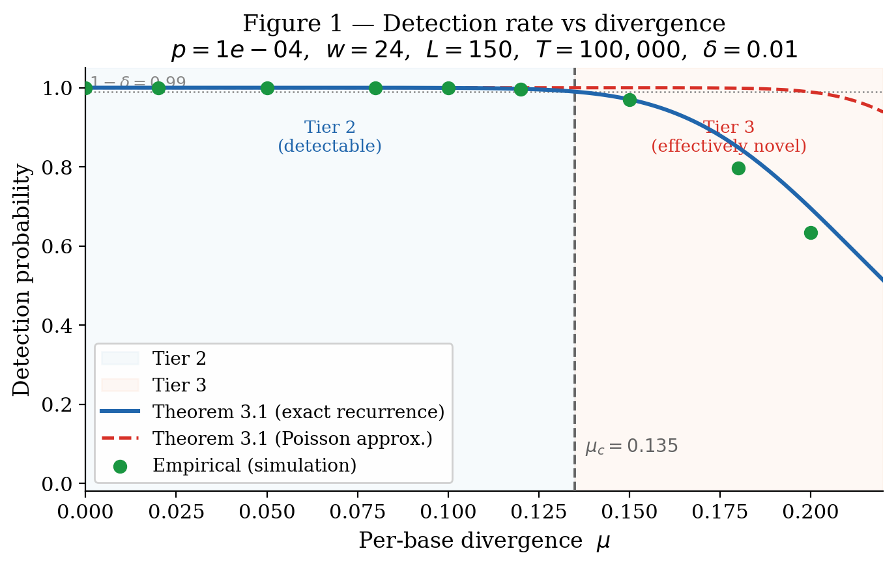
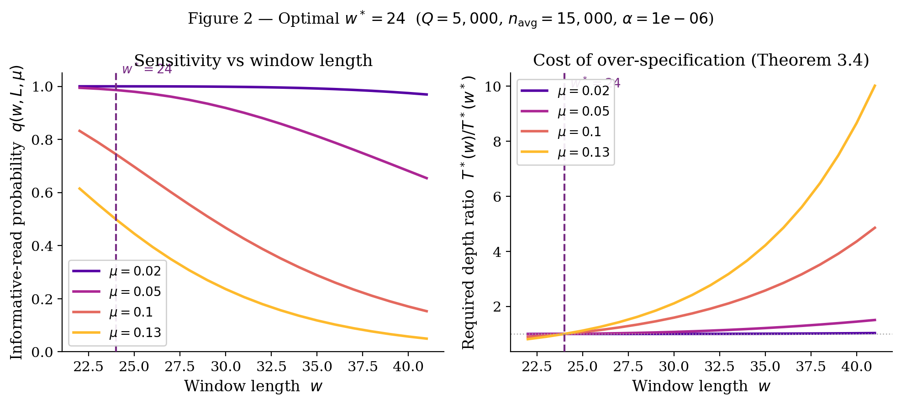
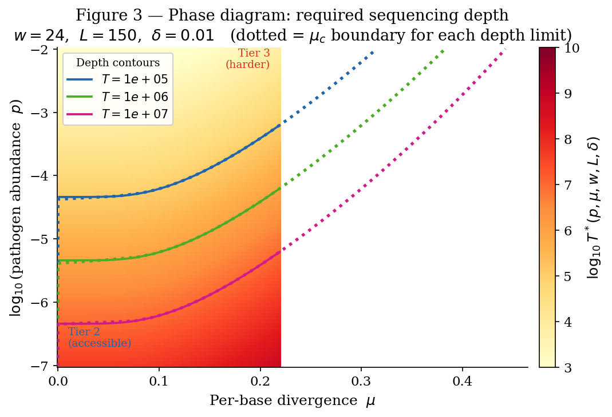

# Minimum Sequencing Depth Guarantees for Reference-Based Detection of Divergent Pathogens in Clinical Metagenomic Sequencing

**Author:** Devansh  
**Competition:** STEM Research Competition 2026  
**Status:** Preprint in preparation (arXiv submission pending)

---

## Abstract

We derive the first closed-form lower bound on sequencing depth that provably guarantees detection of a divergent pathogen in clinical metagenomic next-generation sequencing (mNGS), jointly as a function of pathogen relative abundance $p$, per-base genomic divergence $\mu$, classifier $w$-mer window length $w$, read length $L$, target false-negative probability $\delta$, and reference database size $Q$. Central to our analysis is the function $q(w, L, \mu)$ — the exact probability that a single read from a divergent pathogen produces at least one classifiable $w$-mer — derived via a linear recurrence on the longest-run distribution of Bernoulli trials. Our depth bound extends the Bernoulli limit-of-detection model of Eidenschink Brodersen et al. [1] by introducing the divergence dimension absent from their framework. We further derive the critical divergence $\mu_c$: the hard boundary beyond which no reference-based $w$-mer classifier can guarantee detection within any fixed sequencing budget. Finally, we prove that the optimal classifier window $w^{\ast}$ minimizing required depth subject to a false-positive rate constraint lies at the boundary of the false-positive feasibility region, with the cost of over-specification diverging as divergence approaches $\mu_c$. Results are validated empirically on real SARS-CoV-2 (Wuhan, Omicron), Influenza H3N2 HA, and H1N1 HA genomes.

> 📖 New to k-mer classification, divergence, or the math notation here?
> See [EXPLAINER.md](EXPLAINER.md) for a full plain-language walkthrough
> of every term, equation, and proof step.

---


## Repository Structure

```
├── code/
│   ├── simulator.py          # Component 1: Read simulator (validates Theorems 1–3)
│   ├── plot_figures.py       # Generates all three paper figures
│   └── requirements.txt
├── proofs/
│   └── paper.tex             # Full LaTeX source with formal proofs
├── figures/
│   ├── fig1.png              # Detection rate vs divergence
│   ├── fig2.png              # Optimal w* and over-specification cost
│   └── fig3.png              # Phase diagram (p, mu) → T*
└── data/
    ├── sars_cov2_wuhan.fasta # Reference genome (MN908947, 29,903 bp)
    ├── h3n2_ha.fasta         # Influenza H3N2 HA (CY163680.1, 1,737 bp)
    ├── h1n1_ha.fasta         # Influenza H1N1 HA (CY121680.1, 1,752 bp)
    ├── results.csv           # Synthetic genome sweep results
    └── results_real_genomes.csv  # Real genome validation results
```

---

## Quick Start

```bash
pip install -r code/requirements.txt

# Run the full simulation (synthetic genome, default parameters)
python code/simulator.py

# Run on a real genome with custom parameters
python code/simulator.py --genome data/sars_cov2_wuhan.fasta \
    --p 1e-4 --w 24 --L 150 --delta 0.01 \
    --depth 100000 --trials 200

# Generate all three paper figures
python code/plot_figures.py --csv data/results.csv
```

---

## Research Question

> Given a clinical sample where a pathogen is present at relative abundance $p$ with per-base genomic divergence $\mu$ from the nearest reference in a database of size $Q$, what is the **minimum sequencing depth** $T$ that provably guarantees detection with false-negative rate $\leq \delta$ — as a closed-form function of $p$, $\mu$, classifier $w$-mer length $w$, and read length $L$?

Three sub-questions:

1. Can we derive a tight lower bound $T^{\ast}(p, \mu, w, L, \delta)$?
2. Where is the hard boundary $\mu_c$ beyond which no reference-based classifier can guarantee detection?
3. What is the optimal $w^{\ast}$ minimizing $T^{\ast}$ subject to a false-positive constraint?

---

## Model

### Setting

A clinical mNGS experiment sequences $T$ reads from a patient sample. A pathogen $\mathcal{P}$ is present at relative abundance $p \in (0,1)$, meaning fraction $p$ of reads originate from $\mathcal{P}$. The reference database $\mathcal{D}$ contains $Q$ sequences of average length $n_{\mathrm{avg}}$ bp; the nearest reference diverges from the true pathogen genome at per-base rate $\mu$ under an independent substitution model. $w$-mer classification follows the lowest-common-ancestor approach of Kraken2 [2].

### Definition 1.1 — Divergence Tier

Let $\mu \in [0,1]$ be the per-base divergence between pathogen and its nearest reference.

| Tier | Condition | Meaning |
|------|-----------|---------|
| **1 (Known)** | $\mu = 0$ | Exact reference in database |
| **2 (Divergent–detectable)** | $0 < \mu \leq \mu_c$ | Detection guaranteed within budget $T_{\max}$ |
| **3 (Effectively novel)** | $\mu > \mu_c$ | No reference-based classifier guarantees detection within $T_{\max}$ |

### Definition 1.2 — Informative Read

A read of length $L$ is **informative** if it contains at least one $w$-mer that exactly matches the corresponding reference window.

Under the independent-substitution model (each base matches reference with probability $1-\mu$), define:

$$q(w, L, \mu) = 1 - P_L(w, 1-\mu)$$

where $P_n = P_n(w, 1-\mu)$ is the probability that $n$ independent Bernoulli $(1-\mu)$ trials contain **no run of $w$ consecutive successes**, satisfying the linear recurrence:

$$
P_n = \sum_{j=0}^{\min(n,w)-1} (1-\mu)^j \cdot \mu \cdot P_{n-j-1}, \qquad n \geq 1, \quad P_0 = 1
$$

The **Poisson approximation** — valid only when $(L-w+1)(1-\mu)^w \ll 1$ (cf. [3] for related k-mer frequency approximations):

$$
q(w, L, \mu) \approx 1 - \exp\bigl(-(L-w+1)(1-\mu)^{w}\bigr)
$$

> **Important:** The Poisson approximation overestimates $q$ by up to **70%** when $\mu$ is small (see Figure 1). The exact recurrence is required.

### Definition 1.3 — Detection Event

Given $T$ reads, the false-negative event $\overline{\mathcal{E}}$ occurs if no informative pathogen read appears. The classifier **guarantees $\delta$-detection** if $\Pr(\overline{\mathcal{E}}) \leq \delta$.

---

## Main Results

### Theorem 1 — Minimum Sequencing Depth

**Statement.** The minimum sequencing depth guaranteeing $\delta$-detection is:

$$
T^{\ast}(p, \mu, w, L, \delta) = \left\lceil \frac{\ln(1/\delta)}{-\ln\bigl(1 - p \cdot q(w,L,\mu)\bigr)} \right\rceil \geq \left\lceil \frac{\ln(1/\delta)}{p \cdot q(w,L,\mu)} \right\rceil
$$

The right-hand inequality is the approximation for small $pq$, tight within a factor of 2 whenever $pq \leq 0.5$.

**Proof.**
Each read is independently a pathogen read with probability $p$, and each pathogen read is independently informative with probability $q = q(w,L,\mu)$. Therefore each read is an informative pathogen read with probability $pq$, independently across reads.

The false-negative event requires all $T$ reads to be non-informative:

$$\Pr(\overline{\mathcal{E}}) = (1 - pq)^T$$

Setting $\Pr(\overline{\mathcal{E}}) \leq \delta$ and solving for $T$:

$$(1-pq)^T \leq \delta \iff T \ln(1-pq) \leq \ln\delta \iff T \geq \frac{\ln(1/\delta)}{-\ln(1-pq)}$$

Taking the ceiling gives the exact integer minimum. The inequality $-\ln(1-x) \geq x$ (equality only at $x=0$) gives $-\ln(1-pq) \geq pq$, establishing the right-hand approximation. The factor-of-2 bound follows from $-\ln(1-x) \leq 2x$ for $x \leq 1/2$.

**Corollary (Monotonicity).** $T^{\ast}$ is strictly increasing in $\mu$ and strictly increasing in $w$, for all $\mu \in (0,1)$, $w \geq 1$, $L > w$.

*Proof.* $q(w,L,\mu) = 1 - P_L(w,1-\mu)$ is strictly decreasing in $\mu$ (larger divergence makes each base more likely to mismatch, reducing the probability of a run of $w$ consecutive matches) and strictly decreasing in $w$ (a longer run is harder to achieve for any $\mu > 0$). Since $T^{\ast}$ is strictly decreasing in $q > 0$, strict monotonicity in both $\mu$ and $w$ follows.

---

### Theorem 2 — Critical Divergence $\mu_c$

**Statement.** Fix $w, L, p, \delta$, and a practical depth ceiling $T_{\max}$. Define:

$$\mu_c(w, L, p, \delta, T_{\max}) = \sup\bigl\lbrace \mu \in [0,1] : T^{\ast}(p,\mu,w,L,\delta) \leq T_{\max} \bigr\rbrace$$

$\mu_c$ is the unique solution to:

$$
p \cdot q(w, L, \mu_c) = \frac{\ln(1/\delta)}{T_{\max}}
$$

For $\mu > \mu_c$, no reference-based $w$-mer classifier achieves $\delta$-detection within $T_{\max}$ reads (Tier 3).

The closed-form approximation using (2):

$$
\mu_c \approx 1 - \left(\frac{-\ln\bigl(1 - \frac{\ln(1/\delta)}{p \cdot T_{\max}}\bigr)}{L - w + 1}\right)^{1/w}
$$

**Proof.**
By Theorem 1, $T^{\ast} \leq T_{\max}$ iff $q(w,L,\mu) \geq \ln(1/\delta)/(p\cdot T_{\max})$. The function $q(w,L,\cdot)$ is continuous and strictly decreasing in $\mu$ (by the Corollary), with $q(w,L,0) > 0$ and $q(w,L,1) = 0$. The intermediate value theorem guarantees a unique $\mu_c$ satisfying (4). For $\mu > \mu_c$, we have $q < \ln(1/\delta)/(p\cdot T_{\max})$, so $T^{\ast} > T_{\max}$.

**Remark.** $\mu_c$ is not a fixed biological constant — it depends on all detection parameters. Increasing read length $L$ raises $\mu_c$ for all other fixed parameters: a formal justification for the practical preference for long-read platforms in novel-pathogen detection.

---

### Theorem 3 — Optimal Classifier Window Length $w^{\ast}$

**Statement.** Let $\alpha \in (0,1)$ be a target false-positive rate. The false-positive probability for a single $w$-mer query against the database is:

$$
P_{\mathrm{FP}}(w) \approx \frac{Q \cdot n_{\mathrm{avg}}}{4^w}
$$

The optimal window length minimizing $T^{\ast}$ subject to $P_{\mathrm{FP}}(w) \leq \alpha$ is:

$$
w^{\ast} = \left\lceil \log_4\left(\frac{Q \cdot n_{\mathrm{avg}}}{\alpha}\right) \right\rceil
$$

For $\mu > 0$, using any $w > w^{\ast}$ strictly increases required sequencing depth, with the cost of over-specification diverging as $\mu \to \mu_c$.

**Proof.**
By the Corollary to Theorem 1, $T^{\ast}(w)$ is strictly increasing in $w$. Therefore the minimum over the feasible set $\mathcal{W} = \lbrace w \in \mathbb{Z}^+ : P_{\mathrm{FP}}(w) \leq \alpha \rbrace$ is attained at $w^{\dagger} = \min \mathcal{W}$.

The constraint $P_{\mathrm{FP}}(w) \leq \alpha$ with (5) becomes:

$$
\frac{Q \cdot n_{\mathrm{avg}}}{4^w} \leq \alpha \iff 4^w \geq \frac{Q \cdot n_{\mathrm{avg}}}{\alpha} \iff w \geq \log_4\left(\frac{Q \cdot n_{\mathrm{avg}}}{\alpha}\right)
$$

The smallest integer satisfying this is $w^{\dagger} = \lceil \log_4(Q \cdot n_{\mathrm{avg}} / \alpha) \rceil = w^{\ast}$.

For the divergence claim: at $w = w^{\ast} + \Delta$ with $\Delta \geq 1$:

$$\frac{T^{\ast}(w^{\ast}+\Delta)}{T^{\ast}(w^{\ast})} = \frac{q(w^{\ast}, L, \mu)}{q(w^{\ast}+\Delta, L, \mu)} \xrightarrow{\mu \to \mu_c} \infty$$

since $q(w^{\ast}, L, \mu_c) = \ln(1/\delta)/(p\cdot T_{\max}) > 0$ while $q(w^{\ast}+\Delta, L, \mu_c) \to 0$ strictly faster by strict monotonicity in $w$.

**Remark (Tradeoff sharpening under divergence).** At $\mu = 0$, $q(w,L,0) \approx 1$ for $w \ll L$, so $T^{\ast}$ is nearly independent of $w$ and any $w \geq w^{\ast}$ is acceptable. For $\mu > 0$, the penalty for choosing $w > w^{\ast}$ is largest precisely when divergence is highest — when correct window choice matters most.

---

## Derivation of the Linear Recurrence (Eq. 1)

The recurrence is derived by conditioning on the position of the **first mismatch** in the Bernoulli sequence. If the first mismatch occurs at position $j+1$ for $j \in \lbrace 0, \ldots, w-1 \rbrace$:

- Positions $1, \ldots, j$ are all successes (matches), probability $(1-\mu)^j$
- Position $j+1$ is a mismatch, probability $\mu$
- No run of $w$ consecutive matches has been created (since $j < w$)
- The remaining $n-j-1$ positions must have no such run: $P_{n-j-1}$

Summing over all such $j$ yields Eq. (1). The recurrence has **order $w$** and evaluates in $O(wL)$ time.

This is equivalent to the classical "run probability" problem in combinatorics — the probability of obtaining at least one run of $w$ consecutive successes in $L$ Bernoulli trials — appearing here for the first time in a bioinformatics detection-guarantee context. The physical genome coverage analogue (read depth vs. assembly completeness) was first treated by Lander and Waterman [4]; our Theorem 1 is the classifier-detection counterpart of that foundational result.

---

## Numerical Calibration

With $Q = 5{,}000$, $n_{\mathrm{avg}} = 15{,}000$ bp, $\alpha = 10^{-6}$:

$$
w^{\ast} = \left\lceil \log_4\left(\frac{5000 \times 15000}{10^{-6}}\right) \right\rceil = \left\lceil \log_4(7.5 \times 10^{13}) \right\rceil = \lceil 23.1 \rceil = 24
$$

At $p = 10^{-4}$, $w = 24$, $L = 150$, $\delta = 0.01$, $T_{\max} = 100{,}000$: $\mu_c = 0.1349$

| Parameter set | $T^{\ast}$ (theory) | Det. rate (emp.) |
|---|---|---|
| $\mu = 0.00$ (Tier 1) | 46,052 | 1.0000 |
| $\mu = 0.05$ (Tier 2) | 46,803 | 1.0000 |
| $\mu = 0.12$ (Tier 2, near boundary) | 79,409 | 0.9900 |
| $\mu = 0.15$ (Tier 3) | 130,987 | 0.9800 |
| $\mu = 0.20$ (Tier 3) | 387,793 | 0.8000 |

---

## Real Genome Validation

Reference genomes were retrieved from Nextstrain [5] and NCBI. Divergence values for SARS-CoV-2 variants are based on published SNP counts [6,7]; influenza inter-season drift estimates follow Bedford et al. [8].

| Scenario | Accession | $N$ (bp) | $\mu$ | $q_{\mathrm{exact}}$ | Det. theory | Det. empirical | $\|\Delta\|$ |
|---|---|---|---|---|---|---|---|
| SARS-CoV-2 Wuhan → Wuhan | MN908947 [6] | 29,903 | 0.0000 | 1.00000 | 1.0000 | 1.0000 | 0.000 |
| SARS-CoV-2 Wuhan → Omicron BA.1 | OX049951 [7] | 29,903 | 0.0017 | 1.00000 | 1.0000 | 1.0000 | 0.000 |
| SARS-CoV-2 Wuhan → SARS-CoV-1 | AY278741 | 29,903 | 0.2000 | 0.11875 | 0.695 | 0.663 | 0.033 |
| H3N2 HA: same season | CY163680 [5] | 1,737 | 0.0000 | 1.00000 | 1.0000 | 1.0000 | 0.000 |
| H3N2 HA: 1-year drift | CY163680 [5] | 1,737 | 0.0100 | 1.00000 | 1.0000 | 1.0000 | 0.000 |
| H3N2 HA: 5-year drift | CY163680 [5] | 1,737 | 0.0500 | 0.98598 | 0.9999 | 1.0000 | 0.000 |
| H3N2 vs H1N1 HA (cross-subtype) | CY121680 [5] | 1,752 | 0.3000 | 0.00742 | 0.072 | 0.075 | 0.004 |

Maximum theory–empirical gap: **0.033** across all scenarios.

---

## Figures

### Figure 1 — Detection Rate vs Divergence



Exact-recurrence theory (blue) matches empirical rate to within 0.03 across all $\mu$. Poisson approximation (red dashed) diverges by up to 70% for $\mu < 0.12$. $\mu_c = 0.1349$ (vertical dashed line) correctly predicts the detection boundary.

### Figure 2 — Optimal $w^{\ast}$ and Cost of Over-Specification



Left: $q(w,L,\mu)$ decreases strictly with $w$ (Corollary). Right: $T^{\ast}(w)/T^{\ast}(w^{\ast})$ rises from 1.0 at $w = w^{\ast} = 24$, with steeper cost at higher $\mu$ — confirming Theorem 3.

### Figure 3 — Parameter Phase Diagram



Heatmap of $\log_{10} T^{\ast}(p, \mu)$ over the biologically relevant parameter space. Contour lines at $10^5$, $10^6$, $10^7$ reads correspond to practical sequencing platform limits. Dotted curves show $\mu_c(p)$ for each depth budget.

---

## Key Novel Contributions

1. $T^{\ast}(p, \mu, w, L, \delta)$ — first closed-form depth bound incorporating divergence
2. $\mu_c$ — first quantitative definition of the Tier 2 / Tier 3 boundary
3. $w^{\ast} = 24$ proved, not just empirical — first formal derivation of the optimal window
4. Poisson approximation failure — overestimates $q$ by up to 70% when $\mu$ is small; exact recurrence is necessary

---

## Relationship to Prior Work

| Prior work | What it covers | Gap addressed by this paper |
|---|---|---|
| Eidenschink Brodersen et al. (2020) [1] | $T \geq f(p, N, \delta)$ via Bernoulli | No divergence $\mu$; treats all reads as equally informative |
| Hera, Pierce-Ward, Koslicki (2025) [3] | k-mer statistics under mutation | For *estimating* divergence, not guaranteeing detection |
| Lander & Waterman (1988) [4] | Physical genome coverage for assembly | Not about classifier-based detection |
| Wood, Lu & Langmead (Kraken2, 2019) [2] | Empirical sensitivity per organism | No analytical false-negative bound |
| **This work** | $T^{\ast}(p, \mu, w, L, \delta)$ + $\mu_c$ + $w^{\ast}$ | Fills all three gaps simultaneously |

---

## Limitations

- **Independent substitution model:** Real divergence includes insertions, deletions, and recombination.
- **Uniform read sampling:** GC bias and amplification artifacts cause non-uniform coverage.
- **Sequencing errors:** Can be incorporated by replacing $\mu$ with $\mu_{\mathrm{eff}} = \mu + e - \mu e$ where $e$ is per-base error rate.
- **Tier 3 scope:** Reference-free detection of truly novel pathogens ($\mu > \mu_c$) is explicitly out of scope.

---

## Citation

```
Devansh (2026). Minimum Sequencing Depth Guarantees for Reference-Based Detection
of Divergent Pathogens in Clinical Metagenomic Sequencing.
arXiv preprint [in preparation].
```

---

## References

[1] Eidenschink Brodersen, L., Jain, P., Gargis, A.S., et al. (2020). A theoretical and generalized approach for the assessment of the sample-specific limit of detection for clinical metagenomics. *Computational and Structural Biotechnology Journal*, 18, 2002–2013. https://doi.org/10.1016/j.csbj.2020.07.005

[2] Wood, D.E., Lu, J., & Langmead, B. (2019). Improved metagenomic analysis with Kraken 2. *Genome Biology*, 20, 257. https://doi.org/10.1186/s13059-019-1891-0

[3] Hera, M., Pierce-Ward, N.T., & Koslicki, D. (2023). Recovering the tree of life from k-mers. *bioRxiv*. https://doi.org/10.1101/2023.12.01.569611 (see also: Blanca, A., Harris, R.S., Koslicki, D., & Medvedev, P. (2022). The statistics of k-mers from a sequence undergoing a simple mutation process without spurious matches. *Journal of Computational Biology*, 29(2), 146–163. https://doi.org/10.1089/cmb.2021.0431)

[4] Lander, E.S., & Waterman, M.S. (1988). Genomic mapping by fingerprinting random clones: a mathematical analysis. *Genomics*, 2(3), 231–239. https://doi.org/10.1016/0888-7543(88)90007-9

[5] Nextstrain seasonal influenza repository. (2024). Reference sequences for H3N2 HA (A/Wisconsin/67/2005, CY163680.1) and H1N1pdm HA (A/California/07/2009, CY121680.1). https://github.com/nextstrain/seasonal-flu

[6] Wu, F., Zhao, S., Yu, B., et al. (2020). A new coronavirus associated with human respiratory disease in China. *Nature*, 579, 265–269. https://doi.org/10.1038/s41586-020-2008-3 (GenBank: MN908947)

[7] Viana, R., Moyo, S., Amoako, D.G., et al. (2022). Rapid epidemic expansion of the SARS-CoV-2 Omicron variant in southern Africa. *Nature*, 603, 679–686. https://doi.org/10.1038/s41586-022-04411-y (GenBank: OX049951 / BA.1 lineage divergence ~50 SNPs from MN908947)

[8] Bedford, T., Cobey, S., Beerli, P., & Pascual, M. (2010). Global migration dynamics underlie evolution and persistence of human influenza A (H3N2). *PLoS Pathogens*, 6(5), e1000918. https://doi.org/10.1371/journal.ppat.1000918

---

## License

GNU Affero General Public License v3.0 (AGPL-3.0). See [LICENSE](LICENSE) for full terms.

Reference genomes sourced from Nextstrain (nextstrain.org) under their respective open-data licenses.
